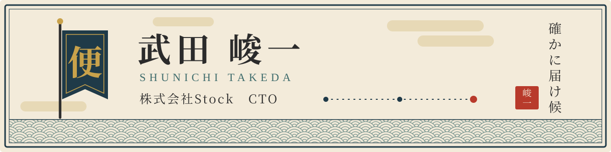

  

  

  飛脚は、預かった文（ふみ）を刻限までに届けて、はじめて飛脚にございます。 
  手前の生業も同じく、チームの文が、要る人の手元へ確かに届く仕掛けを拵えることにございます。

---

### 一、名乗り

株式会社Stock にて CTO を相務めております、武田峻一と申します。
情報共有の「Stock」と、社内ナレッジ管理の「ナレカン」、二つの店の普請（開発）と見廻り（運用）を預かっております。

### 二、生業

- [Stock](https://www.stock-app.info/) — チームの情報を、最も簡単に残し、管理するための道具
- [ナレカン](https://www.narekan.info/) — 社内に散らばったナレッジを一所に集め、AI にて探し出すための道具

### 三、心得

<pre>
　定（さだめ）

一、都合の悪しき事ほど、先に申し上ぐべき事
一、拵えられるか否かではなく、回し続けられるか否かにて決むべき事
一、後で戻せる内は決めて進み、戻せぬ所にては止まりて確かむべき事
一、出来上がりを写させず、拵え方の勘所を渡すべき事

　右之通（みぎのとおり）　武田
</pre>

### 四、近頃の取り組み

設計・試し（テスト）・見廻りの持ち場に AI エージェントを入れ、少ない人手でも早く確かに届ける道を探っております。

もっとも、手放しで任せられるのは今のところ一部の持ち場のみにて、どこまで任せてよいかの線は、日々引き直しているところにございます。

### 五、道具箱

- 帳場（バックエンド）: Ruby on Rails・PostgreSQL
- 店先（フロントエンド）: React・TypeScript
- 持ち歩き（モバイル）: React Native
- 街道（インフラ）: AWS（ECS・Aurora・OpenSearch・WAF）
- からくり（AI）: LLM・RAG・AI エージェント

### 六、瓦版

[Stock Tech Blog（Zenn）](https://zenn.dev/p/stock_inc) にて、現場で踏み抜いた落とし穴と、その越え方を書き付けております。

<!-- BLOG-POST-LIST:START -->
- [パッチを当てられない側の脆弱性対応 — 共有サーバーのPHP重大脆弱性を、CDNの手前で止血した](https://zenn.dev/stock_inc/articles/shared-hosting-php-vuln-l7-stopgap)
- [AIエージェントで「報告の手間ゼロ」のデイリーレポートを実現した話](https://zenn.dev/stock_inc/articles/ai-agent-daily-report-zero-overhead)
- [AIエージェントが「見えない不具合」をどう見つけたか — PDFの透明テキストレイヤーを可視化で解決した話](https://zenn.dev/stock_inc/articles/ai-agent-invisible-ocr-debug)
- [AI活用の知見をClaude内に閉じ込めない — Claude Codeと実Chromeを『相乗り』させる](https://zenn.dev/stock_inc/articles/claude-code-chrome-extension-web-output)
- [LLMにもEOLがある — モデルを依存ライブラリとして管理する](https://zenn.dev/stock_inc/articles/llm-model-eol-lifecycle-management)
<!-- BLOG-POST-LIST:END -->

### 七、道中の荷

手前が背負うて歩いております、公開の品々にございます。

- [stock-plus](https://github.com/Shunichi-Takeda/stock-plus) — Stock に機能を足す Chrome 拡張の道具一式
- [Kaigi-Support-Chrome-Extension](https://github.com/Shunichi-Takeda/Kaigi-Support-Chrome-Extension) — Google カレンダーに、会議の次第書きを拵える窓を足す Chrome 拡張
- [stock-inc-games](https://shunichi-takeda.github.io/stock-inc-games/) — 社内の手すさびにて拵えた HTML の遊び集

### 八、文の宛先

- 瓦版（技術記事）: [zenn.dev/p/stock_inc](https://zenn.dev/p/stock_inc)
- 店（会社）: [株式会社Stock](https://www.stock-inc.co.jp/)

  

